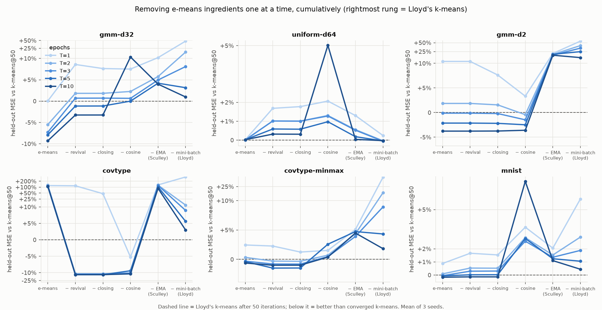
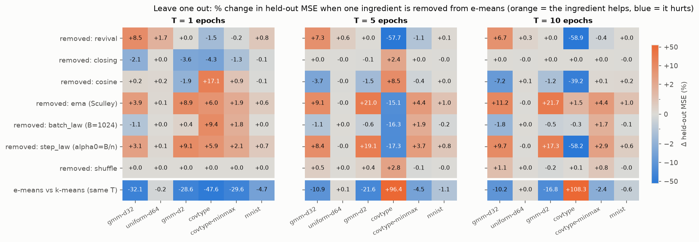
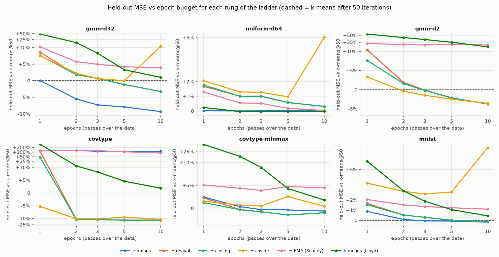

# e-means ablation: which parts actually beat k-means?

[e-means](https://github.com/facebookresearch/faiss/tree/main/contrib/e_means)
([paper](https://arxiv.org/abs/2611.09501)) is a mini-batch replacement for
Lloyd's k-means from Meta FAIR. It claims lower loss than k-means in about a
tenth of the epochs. The paper compares the finished algorithm against
k-means. This repo takes it apart and measures what each ingredient adds, with
k-means as the reference at every step.

Two experiments, both measured as **held-out MSE** (squared distance from test
points to their nearest centroid):

1. **Ladder (cumulative removal).** Start from full e-means. Remove one
   ingredient at a time until what is left is plain Lloyd's k-means. Each rung
   is compared against k-means run for the same number of epochs, and against
   k-means run to convergence (50 iterations).
2. **Leave one out.** Remove exactly one ingredient from full e-means, and
   keep all the others.

## The ingredients

| switch | what e-means does | what removing it does |
|---|---|---|
| `revival` | Every 5 updates, clusters whose EMA mass is below 0.1 × the mean are re-seeded by splitting a heavy cluster (Alg. 1 line 9, App. J). | Never re-seed. |
| `closing` | Returns the plain mean of the points each cluster got during the last epoch (line 12). | Returns the raw EMA positions. |
| `cosine` | Cosine-anneals the EMA step α from α₀ down to 0.1·α₀ (Eq. 5). | Keeps α = α₀ the whole run. |
| `ema` | Each cluster's sum and count are an exponential moving average, with decay γ = 1 − α (Eq. 2). | Sculley's classic mini-batch k-means: counts grow forever, and each cluster's step is n_j / N_j. |
| `batch_law` | Batch size B from the fitted scaling law (Eq. 7). | Fixed B = 1024 (scikit-learn's default). α₀ still comes from the step law for that B. |
| `step_law` | α₀ from the fitted step law (Eq. 6). | α₀ = B/n, an EMA that remembers about one epoch. |
| `shuffle` | A new permutation of the data each epoch. | One permutation, reused every epoch. |
| `minibatch` | Many updates per epoch. | One full-batch update per epoch with α = 1: **Lloyd's k-means**. |

The ladder removes them in this order:
e-means → −revival → −closing → −cosine → −EMA (= Sculley mini-batch k-means)
→ −mini-batch (= Lloyd).

## How it is built

* [`vendor/e_means/`](vendor/e_means) holds the reference NumPy
  implementation, copied unmodified from faiss at commit
  [`ebab8f7`](https://github.com/facebookresearch/faiss/tree/ebab8f784c1d177129602269d5ad966c525fbdcb/contrib/e_means).
* [`ablation/variants.py`](ablation/variants.py) subclasses `NumpyEmeans` and
  overrides only the pieces each switch touches.
* [`ablation/check_equivalence.py`](ablation/check_equivalence.py) checks two
  things. With every switch on, the variant gives **bit-identical** centroids
  and the same recipe as `NumpyEmeans.train`. With `minibatch=False`, it
  matches `faiss.Kmeans` from the same initial centroids, to within float
  rounding, whenever no cluster goes empty.
* The k-means baseline is `faiss.Kmeans`, started from the same initial
  centroids as e-means, with subsampling turned off
  (`max_points_per_centroid=1e9`).
* Every number below is the mean of 3 seeds. Each seed sets the
  initialization, the shuffling and the revivals. Differences are paired by
  seed. Epoch budgets are T ∈ {1, 2, 3, 5, 10}.

| dataset | n train / test | d | k | notes |
|---|---|---|---|---|
| gmm-d32 | 200k / 50k | 32 | 1024 | 2000-component Gaussian mixture, uneven weights and scales |
| uniform-d64 | 200k / 50k | 64 | 1024 | uniform in the unit cube, no cluster structure |
| gmm-d2 | 200k / 50k | 2 | 256 | 2-D mixture. e-means turns revival off at d ≤ 2 by default, so that switch does nothing here |
| covtype | 500k / 81k | 54 | 1024 | UCI Covertype, **z-scored**. The 44 one-hot columns become heavy-tailed: row norm² has a median of 28 and a max of 193,000 |
| covtype-minmax | 500k / 81k | 54 | 1024 | the same data scaled to [0, 1], with no heavy tail |
| mnist | 60k / 10k | 784 | 256 | pixels / 255 |

## Results

### Ladder



At **T = 5 epochs** (e-means' default). Each cell is the held-out MSE change
against k-means run for 5 iterations / for 50 iterations. Negative means
better than k-means.

| rung | gmm-d32 | uniform-d64 | gmm-d2 | covtype (z) | covtype-minmax | mnist |
|---|---|---|---|---|---|---|
| e-means | **−10.9 / −7.9** | +0.1 / +0.0 | **−21.6 / −2.1** | +96.4 / +105.8 | **−4.5 / −0.4** | −1.1 / −0.1 |
| − revival | −4.3 / −1.2 | +0.6 / +0.6 | −21.6 / −2.1 | −16.7 / −12.7 | −5.6 / −1.5 | −1.0 / +0.0 |
| − closing means | −4.3 / −1.1 | +0.6 / +0.6 | −21.7 / −2.2 | −16.7 / −12.7 | −5.5 / −1.5 | −1.0 / +0.0 |
| − cosine schedule | −3.2 / −0.0 | +1.0 / +1.0 | −21.9 / −2.5 | −13.6 / −9.4 | −1.7 / +2.6 | +1.7 / +2.8 |
| − EMA (= Sculley) | +0.9 / +4.2 | +0.2 / +0.2 | −3.7 / +20.3 | +94.8 / +104.2 | +0.4 / +4.7 | +0.2 / +1.2 |
| − mini-batch (= Lloyd) | −0.2 / +3.1 | 0 / 0 | 0 / +24.9 | +1.0 / +5.6 | 0 / +4.3 | 0 / +1.1 |

The other epoch budgets, and the change at each step, are in
[`results/tables.md`](results/tables.md).

### Leave one out



### MSE against epoch budget



## What each ingredient is worth

1. **The forgetting EMA is the core of e-means.** Replace it with Sculley's
   mini-batch k-means, where counts are never forgotten, and the step sizes
   shrink so fast that training stalls. Sculley loses to Lloyd at the same
   epoch count by T = 5 on gmm-d32 and covtype-minmax, and it plateaus about
   20% above converged k-means on gmm-d2. Removing the EMA from full e-means
   costs +9% (gmm-d32), +21% (gmm-d2) and +4% (covtype-minmax) at T = 5.
   The **step law matters for the same reason.** With α₀ = B/n the EMA
   remembers about one epoch, it behaves almost like Sculley, and it loses
   about as much (+8%, +19%, +4%). The precise fitted values matter less than
   making the EMA forget fast.

2. **Mini-batching is where the early-epoch win comes from.** At T = 1–2,
   going from Sculley to Lloyd costs +11% to +39% on the Gaussian mixtures
   and covtype-minmax, and +1% to +4% on mnist. One full-batch step per epoch
   simply makes too few updates. The advantage fades with more epochs. By
   T = 10, plain Lloyd beats Sculley mini-batch k-means on every dataset
   (by 0.1% to 43%).

3. **Revival depends on the dataset more than anything else.**
   * It is worth +7–9% on gmm-d32 at every T. That mixture has 2000 uneven
     components for 1024 centroids, so dead centroids are expensive and
     worth moving.
   * It is roughly neutral (−1% to +1%) on mnist, uniform and covtype-minmax.
   * **It is catastrophic on heavy-tailed data.** On z-scored covtype, e-means
     ends up 2× *worse* than k-means at every T ≥ 2, and the cause is revival
     alone: switch it off and e-means beats converged k-means by 12%. Revival
     treats low-mass clusters as dead. On this data those clusters are the
     ones sitting on rare, far-away points (a few dozen rows with norm² up
     to 10⁵), and those points dominate the MSE. Only about 50 splits do the
     damage. The paper's default turns revival off only at d ≤ 2. Low mass
     is not the same as useless, and it would be safer to judge "unused" by
     the cluster's share of the loss instead of its share of the points.

4. **The cosine schedule mostly matters late, and it interacts with revival.**
   In the ladder, where revival is already gone, removing it costs +4% on
   covtype-minmax at T = 5 and +15% on gmm-d32, +7% on mnist and +5% on
   uniform at T = 10. Holding α at α₀ leaves a noise floor that shows up once
   the other errors are small. In the leave-one-out runs, however, removing
   the schedule while revival is still on *lowers* MSE on gmm-d32 (−4% at
   T = 5, −7% at T = 10). The likely reason is that a larger α keeps
   revived clusters moving. Inside full e-means the schedule's net effect is
   small or negative on most of these datasets.

5. **The closing means do almost nothing.** The change is under 0.05%
   everywhere at T ≥ 2. By the final epoch α has dropped to 0.1·α₀, and the
   EMA positions already sit at the last-epoch means. At T = 1 they
   *hurt* by up to 4%, because they average over a single pass in which the
   centroids were still moving a long way.

6. **The batch law is roughly neutral.** A fixed B = 1024 changes MSE by
   about ±2%, and it is often slightly better because it makes more updates.
   It is worse on covtype-minmax (+1.5% to +1.9%). Z-scored covtype is noisy
   (−16% at T = 5) because of the revival problem above. The batch law matters more for
   throughput (larger batches mean fewer, cheaper Python and kernel calls),
   and wall-clock time was not measured here.

7. **Reshuffling each epoch is negligible** (about ±1%; z-scored covtype is
   again the noisy exception).

8. **When there is nothing to find, everything ties.** On uniform-d64, Lloyd
   converges in 1–2 iterations, and every variant lands within ±1% (5% for
   the no-cosine rung at T = 10).

Overall, e-means beats k-means at the same epoch count mostly through
mini-batching plus an EMA that forgets fast (the step law sets how fast).
Revival brings a large gain on uneven clusterings and a large loss on
heavy-tailed data. The schedule, the closing means, the batch law and
shuffling are second-order.

## Caveats

* Only the CPU NumPy reference was ablated, not the GPU kernels. The other
  implementations do the same math, so the same conclusions should apply.
* 3 seeds per cell. Of the variant-vs-e-means differences larger than 1%,
  152 of 175 have the same sign on all 3 seeds. Per-seed values are in
  `results/runs-*.jsonl`.
* Wall-clock times are recorded in `results/runs-*.jsonl` but are **not
  comparable**: the datasets ran as concurrent processes on one machine.
  These are epoch-for-epoch comparisons only.
* The pure Lloyd rung leaves empty clusters where they are. `faiss.Kmeans`
  re-seeds them, so on mostly random data (uniform-d64) the two can differ
  slightly. The baseline columns always use `faiss.Kmeans`.

## Reproduce

```bash
python -m venv .venv && .venv/bin/pip install -r requirements.txt
cd ablation
../.venv/bin/python check_equivalence.py   # harness == reference e-means, and == Lloyd
../.venv/bin/python run.py --seeds 3       # ~1-2 h on a laptop; resumable
../.venv/bin/python analyze.py             # results/tables.md and figures/*.png
```

The e-means code in `vendor/` is © Meta Platforms, Inc., under the MIT
license. Cite the e-means paper (Bessa et al., 2026, arXiv:2611.09501) for
the algorithm.
